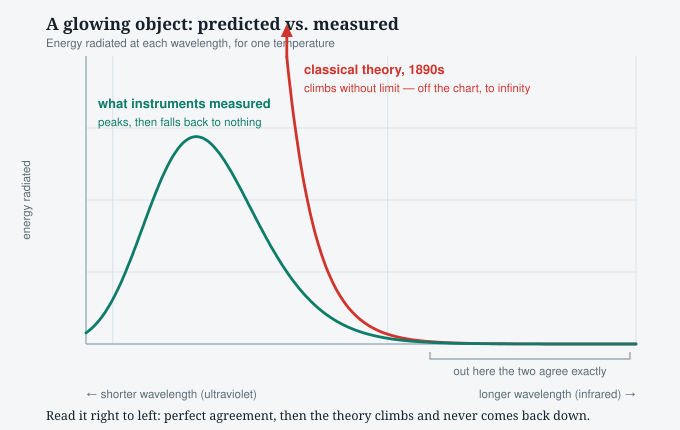
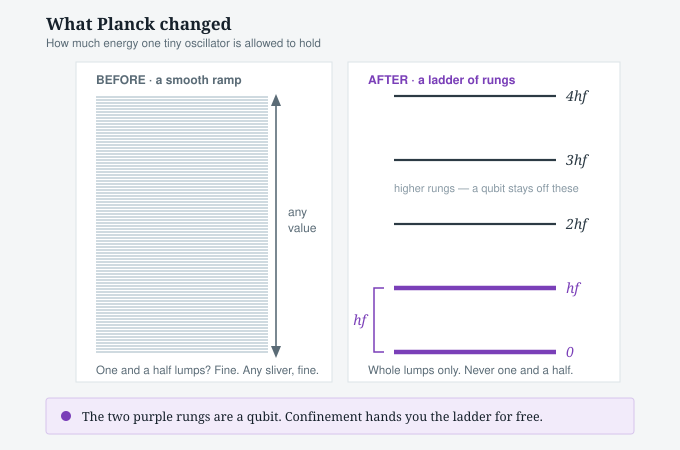

# 01 · 1900 — Energy comes in lumps

## The problem nobody could solve

Heat a piece of metal. It glows red, then orange, then white. Every
object does this, and the colours depend only on temperature — not
on what the object is made of. That universality made it a perfect
test case: physics ought to be able to predict the exact mix of
colours from temperature alone.

By the 1890s the theory was mature and the measurements were
excellent. **They did not agree.**

Read the picture from right to left. At long wavelengths the two
curves sit on top of each other — the theory was not merely close,
it was exact. Then, heading toward short wavelengths, the
measurement peaks and falls away while the theory climbs and never
stops.

Not "somewhat too high." **Infinite.** The accepted physics of the
day predicted that a warm object radiates unlimited energy at short
wavelengths. Every fireplace should sterilise the room with
ultraviolet.

Nobody believed it. Nobody could see what was wrong either. It
picked up a name that stuck: the ultraviolet catastrophe.

## Planck's fix

In late 1900, Max Planck tried something he considered inelegant.

The accepted picture was that the walls of a hot object contain
tiny oscillators that shake and emit light, and — like anything
that vibrates — can hold **any** amount of energy at all. Planck
assumed instead that an oscillator can only hold energy in whole
multiples of one small amount:

> **E = h × f**
>
> energy = a very small constant × the frequency

One lump, two lumps, three lumps. Never one and a half.

Put that restriction in, and the formula matches the measurements
exactly. Across every temperature, every wavelength.

**Why the infinity dies.** High frequency means an expensive lump.
An oscillator cannot emit half of one, so if the object does not
have enough energy on hand to pay the full price, that frequency
emits *nothing at all*. The high-frequency end is not suppressed —
it is priced out. The old theory let those oscillators take any
sliver of energy they liked, and there are endlessly many of them,
so the total ran away.

**h** is Planck's constant, roughly 6.6 × 10⁻³⁴ in everyday units.
It is very close to the smallest number that means anything.

## What Planck actually believed

This is the part usually skipped, and it is the most useful part.

**Planck did not believe energy was really lumpy.** He called it an
act of desperation and treated it as a bookkeeping trick — a step
that made the sum come out, to be removed once someone found the
proper derivation.

He spent roughly the next decade trying to get rid of it. He never
managed. Neither did anyone else, because it was true.

Worth sitting with: the man who started quantum physics spent ten
years trying to un-start it.

## What survived

- **E = hf.** Still exact. Still used daily.
- **The constant h.** Now a defining constant of the SI system —
  the kilogram is defined in terms of it.
- **Discreteness is physically real,** not a calculation device.

## What was discarded

- **That the lumpiness belongs to the wall oscillators.** Einstein
  showed in 1905 it belongs to light itself (chapter 02).
- **Planck's own view that it was a mathematical fiction.** Wrong,
  and he conceded it eventually.
- **The idea that this was a small patch to classical physics.** It
  was the first crack in the whole structure.

## Why it matters for qubits

This chapter is the ancestor of **Rule 1: two outcomes, never a
middle.**

Notice where the two-ness comes from. Nobody drilled two holes in
anything. Planck's oscillators are *confined* — they vibrate in a
bounded space — and confinement alone forces the energy onto a
ladder of rungs instead of a smooth ramp.

That generalises, and it is why qubit hardware was never scarce:
**anything trapped in a confined space has discrete levels.** Every
atom, every electron in a well, every superconducting loop. You get
a ladder for free; you pick the bottom two rungs and stay off the
rest.

The double slit manufactures two alternatives with a barrier.
Nature manufactures them with confinement, everywhere, by default.

---

Index: [00 · Roadmap](00-index.md) ·
Next: 02 · 1905 — Einstein: so does light
